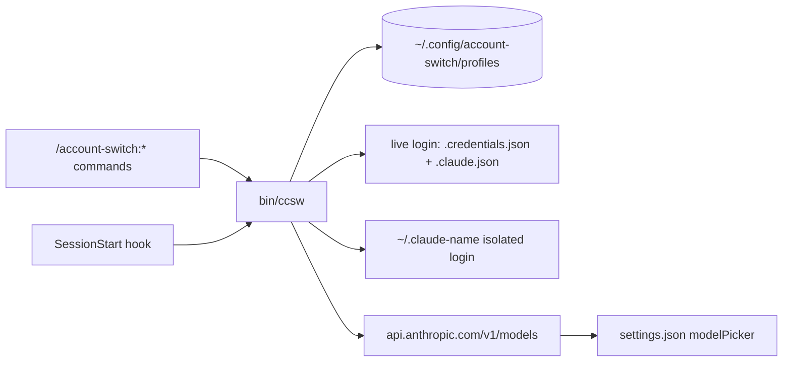

# account-switch

Switch Claude Code between saved claude.ai logins (Pro, Team, Max). Switch every session at once, or one session only. The `/model` list follows the account you are on.

## Install

```
/plugin marketplace add Synx-x/account-switch
/plugin install account-switch@account-switch-marketplace
```

Python 3.9 or newer is the only requirement. The plugin uses the standard library.

## Set up your accounts

Save each login once under a name you choose.

1. Run `claude auth login` with the first account, then `/account-switch:save pro`.
2. Run `claude auth login` with the second account, then `/account-switch:save team`.

Names use `a-z`, `0-9`, `-` and `_`, up to 24 characters.

## Switch

| Command | Effect |
| :- | :- |
| `/account-switch:switch team` | Make `team` the live login for every session. A running session picks it up on its next request. |
| `/account-switch:switch team --session` | Leave the live login alone. Print and copy the command that resumes this conversation on `team`. |
| `/account-switch:switch team --session --open` | Do the same, and start it in a new herdr pane if you use herdr. |
| `/account-switch:status` | Show the live login, the active profile and the saved profiles. |
| `/account-switch:models` | Rebuild the `/model` list now. |

A running session cannot change its own login. So `--session` starts a second process on the same conversation. Use one copy at a time, because both write the same transcript.

### Per-session launchers

`ccsw launchers` writes `~/.local/bin/claude-NAME` for each profile. Run `claude-team` and that session stays on `team` whatever the other sessions do.

Inside Claude Code, `bin/ccsw` is on the Bash tool's PATH. Ask Claude to run `ccsw launchers`. In your own shell, run `python3 <plugin dir>/bin/ccsw launchers` once.

## How it works

A profile is a copy of Claude Code's single login. It holds the tokens from `<config dir>/.credentials.json` and the account record from `.claude.json`. Profiles live in `~/.config/account-switch/profiles`, with directory mode 700 and file mode 600.

- **Global switch:** `ccsw use` writes the profile into the live files. Claude Code reloads `.credentials.json` when its modified time changes.
- **Rotated tokens:** Claude Code rotates refresh tokens. So `use` saves the live login back into its profile before swapping away. It also prefers the fresher token from an isolated directory.
- **Per-session isolation:** `~/.claude-NAME` holds its own login. It symlinks everything else (settings, hooks, plugins, history) to `~/.claude`. `CLAUDE_CONFIG_DIR` points a process at it.
- **Model list:** a session-start hook asks `api.anthropic.com/v1/models` with the live token. It writes the result to `modelPicker` in `settings.json`. Rows read `<profile> · <model id>`. A one-time backup is kept as `settings.json.ccsw-bak`. Turn this off with the plugin setting `auto_sync_models`.
- **Extra models:** set `extra_models_url` to any OpenAI-style `/v1/models` URL, such as a local gateway. Its models are appended to the picker. `extra_models_owners` filters them by `owned_by`.

## Architecture



## Layout

```
account-switch/
├── bin/ccsw                  the whole tool, standard library only
├── commands/                 slash commands that call bin/ccsw
├── hooks/hooks.json          session-start hook that syncs the /model list
├── skills/account-switch/    skill that tells Claude when to use the commands
├── tests/test_ccsw.py        tests against a throwaway HOME
├── .claude-plugin/           plugin manifest and one-plugin marketplace file
├── .agents/                  rules and workflows for AI tools, indexed in AGENTS.md
└── .github/workflows/ci.yml  tests and the tracked-yet-ignored check
```

## Limits

- **macOS:** Claude Code keeps the login in the Keychain. ccsw refuses with a message and does not touch it.
- **Windows:** the global switch works on the credentials file. Isolation needs symlinks, so enable Developer Mode. Launchers are POSIX only, so use `ccsw run NAME` there.
- **Claude Desktop:** the docs describe a separate sign-in flow and a model picker built from the account. This plugin does not switch Desktop accounts. Its commands and hooks load, but the login swap targets the CLI's files.
- **State drift:** an isolated directory gets its own copy of `.claude.json`. Project state there can drift from the main one.
- **Tokens on disk:** profiles hold refresh tokens. Treat `~/.config/account-switch` and `~/.claude-*` like `~/.claude/.credentials.json`.

## Test

```
python3 -m pytest tests
```

The tests run `ccsw` against a throwaway `HOME`. They never touch a real login.

## License

MIT
